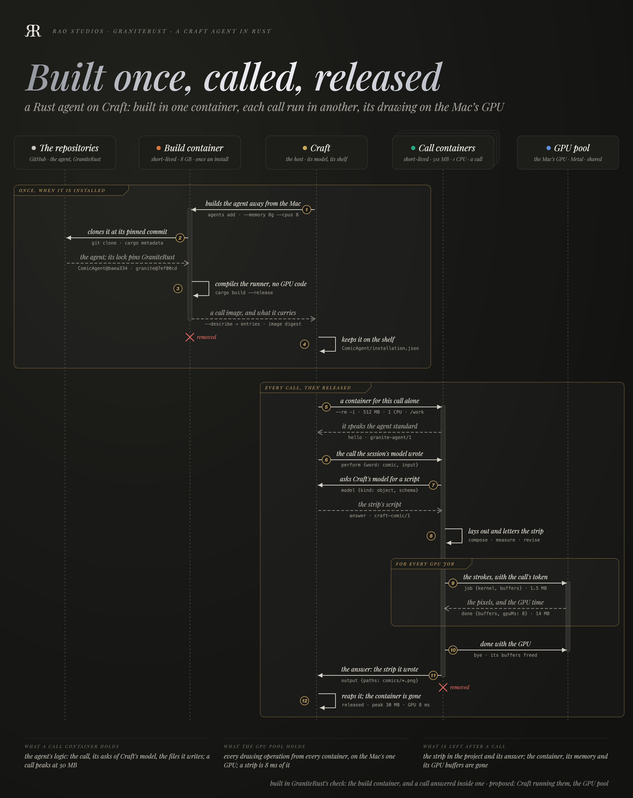

# Short-lived containers and the shared GPU pool

How an agent installed on Craft runs its calls: each call in a container made for it and gone when it has answered,
sized for the agent's logic alone, with every GPU operation sent to one pool of GPU compute on the Mac that all
containers share. This page is the design. What is built today is marked; the rest is proposed and owes its decisions
at the end.

## The rule

- **A container holds logic.** Reading the call, deciding, asking the host's model, writing files, answering: small
  memory, one or two CPUs.
- **The GPU holds compute.** Drawing, filtering, resizing, a model's kernels: sent to the GPU pool, which runs it on
  the Mac's GPU through Metal.
- **The two never trade places.** An agent in a container never computes its image work on the container's CPU, and
  never asks for a container large enough to do so.

## Why the split

A Linux container on a Mac runs in a lightweight VM (Apple's `container`, Virtualization.framework). That VM has no
Metal, and `container` has no option to give it the GPU. What a call needs inside it is small. What needs room is the
build, once, and the GPU, which the VM cannot see.

| Measured on an M4 Max, 2026-11-05 | |
| --- | --- |
| One `comic` call inside a container (a 3-panel strip, CPU path) | peak 30 MB, under 0.1 s of CPU |
| The same call natively on the GPU | peak 61 MB, 0.1 s; 8 ms on the GPU |
| Building `comic` inside a container | killed by memory at the default size: rustc on wgpu's Vulkan bindings (`ash`); passes with 8 GB |
| A container of 256 MB and 1 CPU reaching a service on the Mac | works: the Mac is `192.168.64.1` on the container network (`bridge100`) |
| GPU access from inside the container | none: no Metal, no GPU device, no flag for one |

So memory and CPU were only ever needed for building, and the GPU can only be reached from outside the VM. Each need
gets its own place.

## The lifecycle



The plate is drawn by `Docs/README_Assets/src/lifecycle.py` (Playwright driving Google Chrome, the Playfair Display
Italic face, Rao's mark beside it): `python3 -I Docs/README_Assets/src/lifecycle.py Docs/README_Assets`.

```text
install (once)                                   call (every time)
──────────────                                   ─────────────────
Craft: agents add <repo>                          Craft's turn calls `comic`
  │                                                 │
  ├─ build container (short-lived, large)            ├─ AgentProcess spawns `container run --rm -i … agent`
  │    clone at the pinned commit                    │    (the child is the container CLI; stdin and stdout
  │    cargo build --release, local GPU code off     │     pass through, so the wire is unchanged)
  │    agent --describe                              │
  │    the runner baked into a call image            ├─ call container (short-lived, minimal)
  │                                                  │    hello → perform → notes, model asks → output
  ├─ shelf: <Name>/installation.json                 │    GPU work ──► GPU pool on the Mac ──► results back
  │    entries, image digest, runtime: container     │
  └─ the build container is gone                     └─ answer read, container exits and is removed, cost noted
```

**Install.** Craft's installer runs the build in a short-lived build container (built today:
`containers/Dockerfile` and `containers/check.sh` do exactly this). The agent is compiled with its in-process GPU
code left out (a Cargo feature: `comic-render` without `gpu`), which also removes the build's memory spike, since
wgpu's Vulkan bindings are not compiled. The runner is copied into a minimal call image (Debian slim with nothing
else), whose digest goes into `installation.json` beside the entries. The build container is removed.

**Call.** A call is one container, started for it and removed after it: `container run --rm -i`. Granite's
`AgentProcess` already runs any executable and speaks the wire over its stdin and stdout; for a containerized agent
the executable is the `container` CLI with its arguments, and nothing above it changes. One call, one process, one
container, released.

## The call container's configuration

| Setting | Value | Why |
| --- | --- | --- |
| Image | the agent's call image, by digest | the shelf's tamper check covers the digest as it covers a native runner's SHA-256 |
| `--memory` | 512 MB (the agent may declare less or more, up to a cap) | logic and handoff; a comic call peaks at 30 MB |
| `--cpus` | 1 (2 when declared) | the call's own work is sequential; parallelism is more calls, not bigger ones |
| `--read-only` + `--tmpfs /tmp` | always | the image is never written; scratch space dies with the container |
| `--volume <call folder>:/work` | the call's folder only | `perform.directory` becomes `/work`; the agent sees nothing else of the Mac |
| `--env GRANITE_GPU=<address>`, `GRANITE_GPU_TOKEN=<token>` | per call | where the pool is, and the token that lets this call use it |
| `--rm`, `-i`, `--init` | always | removed after the call; stdin and stdout are the wire; signals forwarded so `cancel` and SIGTERM reach the runner |
| Network | the default container network | reaches the pool at the Mac's container address; reaching anything else is the agent's declared need |
| Lifetime | the call | Craft's cancel stops the container (`container stop`, then `kill` after the grace) as it ends a native runner's group |

Paths cross the boundary once: Craft writes `/work` in place of the project folder into the call and reads paths
under `/work` in the answer back as paths in the project (the one-machine assumption `Docs/federation.md` in Craft
already lists: "files written are named by path").

## The GPU pool

One process on the Mac, owned by Craft (started at launch, as Sewn is, or on the first call that needs it), holding
the GPU device for every container and every agent.

**Its interface is generic compute.** A job is a WGSL compute kernel, its buffers, and a dispatch size; the answer is
the buffers asked for back. Any agent's GPU work fits it: `comic`'s renderer is already a compute shader over storage
buffers (tiles of capsules, one workgroup a 16 px tile), and a filter, a resize or a model's kernels are the same
shape. A library of typed operations (render a scene, resize, filter) can sit on top of it later, in the agents or in
GraniteRust, without changing the pool.

```text
container                                         GPU pool (Mac, Metal via wgpu)
  │ hello  {wire: granite-gpu/1, token}  ───────────►  token checked against the call that holds it
  │ job    {kernel: sha256, source?, entry,    ───────►  pipeline from the cache by sha256, compiled once
  │         buffers: [{binding, bytes, usage}],          buffers created, checked against the limits
  │         dispatch: [x, y, z], read: [bindings]}
  │                                             ◄─────  done {read: [bytes…], gpuMs, queuedMs}
  │ …more jobs…
  │ bye                                        ───────►  the call's resources released, its cost totalled
```

- **Framing.** JSON headers, one per line, as `granite-agent/1`; buffer bytes as length-prefixed binary frames after
  the header that names them, so a 14 MB raster is not base64.
- **Sharing.** One device, one queue per pool; jobs from different calls are scheduled fairly by call, so one agent's
  burst does not starve another's. A call's lanes are still its agent's `lanes`.
- **Caching.** Pipelines by the kernel's SHA-256: a container sends the source once, then only the hash.
- **Limits.** Bytes in and out per job and per call, a dispatch-time watchdog, a cap on jobs in flight per call. A job
  past a limit is refused with the limit in its sentence.
- **Cost.** GPU time, queue time and bytes per job, totalled per call and given back to Craft, which notes it beside
  the process's own cost ("released · peak 30 MB · 0.0 s CPU in 0.2 s · GPU 8 ms").
- **Trust.** The pool listens on the container network's host address only (`192.168.64.1`), never on the LAN. Each
  call gets a token from Craft, valid for that call's lifetime. Kernels are validated before they run (wgpu's naga),
  and buffer access is bounds-checked; a job that fails validation is refused, not run.

## Enforcing it

| Where | The rule | How it is held |
| --- | --- | --- |
| The agent's container build | no in-process GPU code | the build turns the agent's local GPU feature off; an agent whose container build links wgpu's Metal or Vulkan backends fails the install check |
| The agent's run | GPU work goes to the pool | GraniteRust's `granite-gpu` client is the only GPU path in a container build (`GRANITE_GPU` set) |
| No pool, or the pool refuses | the call is refused as `device` | the sentence names what is missing ("the GPU pool is not running: start Craft's GPU pool, or call again"); the agent never falls back to the container's CPU |
| The container's size | logic only | Craft's runner sets `--memory` and `--cpus` from the agent's declaration under a cap; an agent cannot ask for room to compute on the CPU |
| Native runners (today's shelf) | unchanged | an agent run natively may still use the GPU in process, as `comic` does now |

A CPU path stays in the agents for tests and golden images (`comic`'s CPU renderer is its golden reference), never as
a container's fallback for a call.

## What changes where

**GraniteRust**
- `crates/granite-gpu`: the pool (`granite gpu serve`) and its client, `granite-gpu/1` as above, with its own drift
  test like the agent wire's.
- `granite-agents`: the installation record gains `runtime` (`{"kind": "container", "image": "<digest>", "memory":
  "512m", "cpus": 1}`); `AgentInstaller` gains a container target (build container, call image); `AgentProcess` runs
  a container runtime by building the `container run` arguments and mapping `/work`.
- `containers/`: the call image's Dockerfile beside the check image's; `check.sh` checks calls in a minimal
  container with a pool running.

**ComicAgent**
- A third renderer, `pool`, beside `gpu` and `cpu`: the same compute shader, sent to the pool. In a container build it
  is the only renderer; natively `auto` keeps choosing the in-process GPU.

**Craft**
- Starts and owns the pool; hands each containerized call its token and address; reads `runtime` from the shelf and
  runs the container; maps `/work`; shows the pool's cost beside the process's.
- Settings › Agents says where each agent runs (natively, or in a container).

## Built today, proposed

| Piece | State |
| --- | --- |
| Building and checking an agent in a short-lived container (`containers/check.sh`, 8 GB build) | built, passes on ComicAgent |
| A call answered inside a container (CPU path, 30 MB) | built, passes |
| A minimal container reaching a service on the Mac (256 MB, 1 CPU) | verified |
| The GPU pool, `granite-gpu/1`, the client | proposed |
| The call image, `runtime` in the record, Craft's container runner | proposed |
| `comic`'s `pool` renderer | proposed |

## Decisions still owed

1. **The pool's interface.** Generic compute (kernels and buffers, as above), or a fixed list of typed image
   operations. Generic serves every agent and matches how `comic` already draws; typed is simpler to secure and to
   cost.
2. **Who starts the pool.** Craft at launch, or on the first containerized call.
3. **Which agents run in containers.** Every installed agent, or those that declare it (and native for the rest,
   as today).
4. **The call container's caps.** The default and the most an agent may declare.
