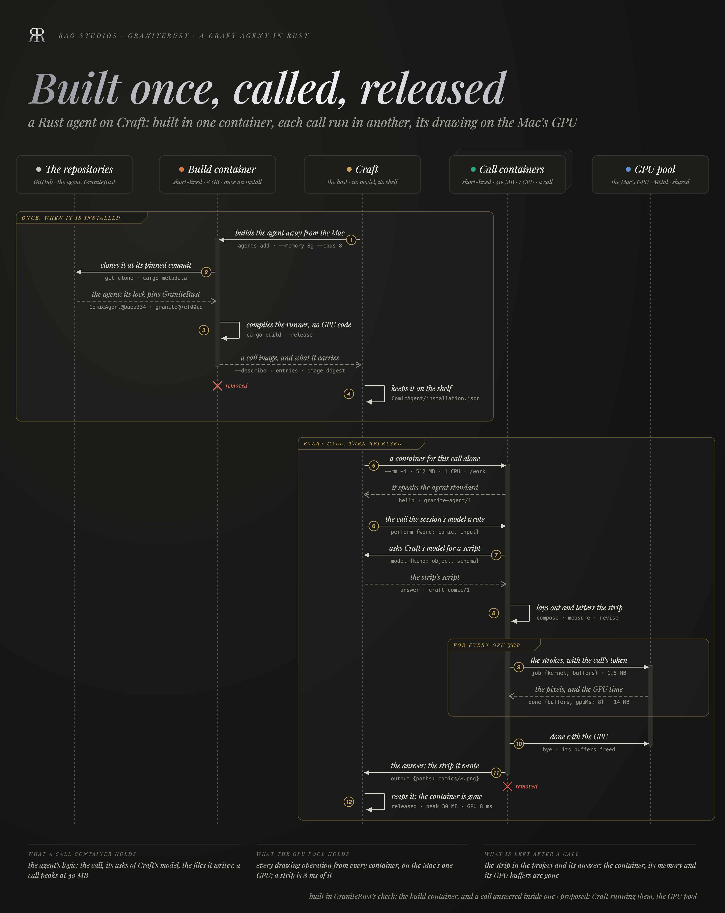

# GraniteRust

Granite's agent kernel and its agent standard, `granite-agent/1`, in Rust. An agent written here is a repository of its
own that a host installs, builds, and calls in a process of its own, JSON in and JSON out, exactly as a host calls a
Swift agent on [Granite](https://github.com/riteshpakala/Granite). The wire, the agent's entry, the installation record
and the answer are byte-compatible: a Swift host (Craft) runs a Rust runner, and a Rust host runs a Swift one.

| Crate | What it is |
| --- | --- |
| [`crates/granite`](crates/granite) | The kernel: one writer on main, centers, reducers and their effects, services and relays, emitters that hold their receivers weakly, tickets, and the agent run engine (`GraniteAgent`, `Agent`) |
| [`crates/granite-agents`](crates/granite-agents) | The standard: agent packages, the schema read off an input, `granite-answer/1`, the wire, a runner's `main`, the host's side of a call, the shelf, and an installer that builds with Cargo |
| [`crates/granite-cli`](crates/granite-cli) | `granite`: install agents on a shelf, describe a runner, run one call by hand, check JSON against the standard |
| [`crates/granite-conformance`](crates/granite-conformance) | A fixture runner (`parrot`) and the tests that drive real processes over pipes |
| [`fixtures/hello-agent`](fixtures/hello-agent) | The smallest agent package there is: the installer's fixture |



The standard itself is [`Schema/GraniteAgent.md`](Schema/GraniteAgent.md) and its four JSON Schemas, copied from Granite
and held to the code by a drift test. [ComicAgent](https://github.com/rao-craft/ComicAgent), a stick-figure comic
strip drawn on the GPU, is the first agent built on it.

## An agent, in three files

```toml
# Cargo.toml
[package]
name = "hello-agent"
edition = "2024"

[package.metadata.granite]
agent = "agent"          # the bin that is the runner

[[bin]]
name = "agent"
path = "src/main.rs"

[dependencies]
granite-agents = { git = "https://github.com/riteshpakala/GraniteRust.git", branch = "main" }
serde = { version = "1", features = ["derive"] }
```

```rust
// src/lib.rs
use granite_agents::{AgentContext, AgentPackage, Answer, BoxError};
use serde::{Deserialize, Serialize};

#[derive(Default)]
pub struct Hello;

#[derive(Deserialize)]
pub struct HelloInput { pub name: String, pub directory: Option<String> }

#[derive(Clone, Default, Serialize)]
pub struct Greeting { pub said: String }

impl AgentPackage for Hello {
    type Input = HelloInput;
    type Event = String;
    type Output = Answer<Greeting>;
    type Compute = ();
    const WORD: &'static str = "hello";
    const SUMMARY: &'static str = "says hello.";

    async fn compute() -> Result<(), BoxError> { Ok(()) }
    fn output(events: Vec<String>) -> Option<Answer<Greeting>> {
        events.last().map(|said| Answer { own: Greeting { said: said.clone() }, ..Default::default() })
    }
    async fn run(&self, input: HelloInput, context: AgentContext<(), String>) -> Result<(), BoxError> {
        context.note(format!("greeting {}", input.name));
        context.deliver(format!("hello, {}", input.name));
        Ok(())
    }
}
```

```rust
// src/main.rs: the whole runner
fn main() {
    granite_agents::AgentServer::main(granite_agents::roster![hello_agent::Hello])
}
```

[`Docs/Agents.md`](Docs/Agents.md) walks through it: the input's schema, `makes`, the answer, refusals, the host's model.

## Using it

```bash
scripts/check.sh                                         # fmt, clippy, the whole suite
GRANITE_AGENT_BUILD=1 cargo test -p granite-conformance  # the installer too, building fixtures/hello-agent
cargo build --release -p granite-cli                     # target/release/granite

granite agents add https://github.com/rao-craft/ComicAgent.git --shelf ~/shelf
granite agents list --shelf ~/shelf
granite describe ~/shelf/ComicAgent/agent
echo '{"perform":{"word":"comic","input":{"script":"strip.png"},"model":false}}' | granite run ~/shelf/ComicAgent/agent - --directory .
containers/check.sh <agent repository> [--native]        # install it in Apple's container and hold its answers to the standard
```

A shelf is never assumed: `--shelf` or `GRANITE_SHELF`. Craft reads any shelf it is pointed at (`CRAFT_AGENTS_DIR`) and
offers a Rust runner there with no change; its own Cargo install path is the next step on Craft's side.

## Docs

- [Kernel](Docs/Kernel.md): Swift Granite's concepts, and where each one is here.
- [Agents](Docs/Agents.md): writing an agent package.
- [Hosting](Docs/Hosting.md): calling runners, the shelf, the installer.
- [Containers](Docs/Containers.md): the check image and what the check holds an agent to.
- [Compute](Docs/Compute.md): agents installed on Craft run each call in a short-lived container sized for logic, with GPU work sent to one shared GPU pool on the Mac.
- [Deviations](Docs/Deviations.md): every deliberate difference from the Swift code.

## Licence

GPL-3.0 ([LICENSE](LICENSE)). An agent's own source may carry any licence that is compatible with it, but a runner
binary links this kernel, so a built runner is a GPL-3.0 combined work.
